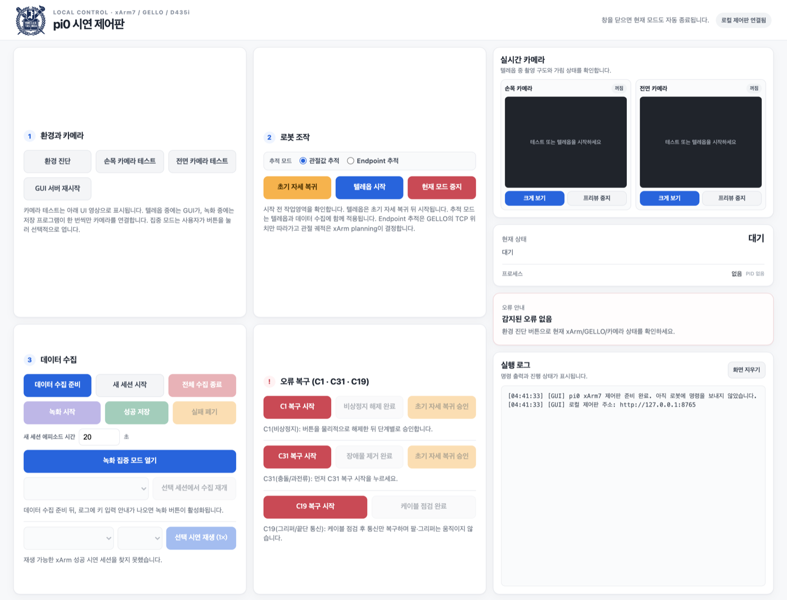
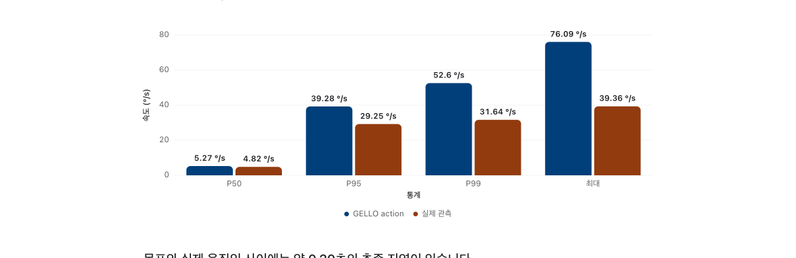

# xArm7 Teleop

A personal robotics experiment for teleoperating an xArm7 with a GELLO leader arm or phone and collecting demonstrations for pi0 training.
The workspace brings together hardware checks, teleoperation, recording, policy training, and replay diagnostics.

- **Type:** Personal robotics experiment
- **Main work:** GELLO/WebXR teleoperation · Local forward kinematics · Demonstration collection · Replay diagnostics
- **Technologies:** Python · LeRobot · OpenPI · xArm SDK · RealSense · WebXR

The local control panel for environment checks, teleoperation, recording, and recovery scripts.

## Overview

| Task | Description |
| --- | --- |
| Teleoperation | GELLO joint/endpoint tracking and 6-DoF phone input through WebXR |
| Demonstration collection | Multi-camera video, including a wrist RealSense, and joint data recorded in LeRobot format |
| Policy training | OpenPI pi0 training procedures for A6000 48 GB LoRA and COSS AGPU full fine-tuning |
| Replay and diagnostics | Demonstration replay, comparison of target and actual motion, and error recovery |

## Implementation

I addressed the effect of initial GELLO encoder offsets on endpoint tracking.
The control mapping adds the leader's displacement to the follower's reference joints. Local forward kinematics reduces network round trips in the 30 Hz control loop.
The teleoperation implementation is in my [fork of the UFACTORY integration](https://github.com/sesepark/lerobot_robot_ufactory/tree/xarm7-gello-webxr).

## Replay Diagnostics

I investigated why replay moved more abruptly than the original demonstration by comparing target actions with observed trajectories.
In the diagnostic below, their peak required velocities were 76.09°/s and 39.36°/s, respectively.

Target actions and actual observations differ even within the same demonstration. The [design and diagnostic notes](docs/design-notes.md) document the cause and differences between replay methods.

## Getting Started

This workspace is configured for specific hardware. First review the safety rules and error handling in the [hardware guide for teammates](05_팀원_공유용_xArm7_사용_안내.md).
Then follow the [environment setup guide](01_환경설정_안내.md) to prepare LeRobot and OpenPI, and the [GUI guide](04_GUI_제어판_사용_안내.md) to launch the control panel.

The GUI binds to `127.0.0.1` and invokes only approved execution scripts.
Teleoperation, recording, camera viewing, and return-to-start are mutually exclusive modes. Switching modes includes a return-to-start procedure.

## Documentation

The linked setup and experiment guides are in Korean.

| Document | Contents |
| --- | --- |
| [Environment setup](01_환경설정_안내.md) | Separate Python, LeRobot, and OpenPI environments |
| [GUI control panel](04_GUI_제어판_사용_안내.md) | Operation, recording, and status checks |
| [Hardware operation](05_팀원_공유용_xArm7_사용_안내.md) | Safety rules, startup procedure, and error codes |
| [WebXR](07_WebXR_휴대폰_텔레옵_사용_안내.md) · [iPhone](08_iPhone_WebXR_텔레옵_사용_안내.md) | Phone connection and operation |
| [Server training](02_OpenPI_서버_학습_안내.md) · [A6000 LoRA](03_OpenPI_A6000_48GB_LoRA_학습_안내.md) · [COSS Full](06_팀원_COSS_AGPU_기준_OpenPI_Full_학습.md) | pi0 training procedures |
| [Design and diagnostic notes](docs/design-notes.md) | Control architecture, contributions, and replay diagnostics |

## Scope and Limitations

- Robot IP addresses and workspace paths are fixed for the current hardware. Other environments require configuration and script changes.
- Datasets and training checkpoints are excluded.
- Running the GUI requires the `uf_lerobot` environment, `run.sh`, and a robot connection.
- WebXR certificates are generated locally and excluded. Errors other than C31 are not cleared automatically.

## Related Projects

- [Teleoperation implementation fork](https://github.com/sesepark/lerobot_robot_ufactory/tree/xarm7-gello-webxr) — GELLO, local FK, and WebXR implementation
- [Original UFACTORY integration](https://github.com/xArm-Developer/lerobot_robot_ufactory) · [OpenPI](https://github.com/Physical-Intelligence/openpi)
- [SO-ARM101 Console](https://github.com/sesepark/soarm101-console) — Teleoperation and demonstration collection on another robotic arm
