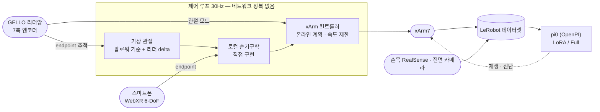

# xArm7 + GELLO + pi0 텔레오퍼레이션 · 데이터 수집 워크스페이스

UFACTORY **xArm7** 로봇팔을 **GELLO 리더암** 또는 **스마트폰(WebXR)** 으로 원격 조작하고, 그
시연을 LeRobot 데이터셋으로 기록해 **pi0(OpenPI)** 정책을 학습·재생하는 연구 워크스페이스임.
실험 장비 앞에서 굴리던 것을 그대로 정리한 것이라, 운용 절차와 오류 복구까지 포함함.

> *A research workspace for teleoperating a UFACTORY xArm7 with a GELLO leader arm or a
> WebXR-capable phone, recording the demonstrations as LeRobot datasets, and training and
> replaying pi0 (OpenPI) policies on them. Operator documentation is in Korean.*


<sub>`127.0.0.1`에만 열리는 로컬 제어판. 임의 쉘 입력창이 없고, 검증된 `run.sh`·`verify.sh`·복구
스크립트만 자식 프로세스로 실행함. 왼쪽 위부터 순서대로 환경 점검 → 조작 → 수집이고, 오른쪽
아래는 실행 로그임.</sub>

---

## 무엇을 하는가

| 단계 | 내용 |
|---|---|
| **텔레옵** | GELLO 리더암(관절 모드 / endpoint 추적 모드) 또는 휴대폰 WebXR 6-DoF 조작 |
| **데이터 수집** | 손목 RealSense 포함 멀티 카메라 동기 기록, 세션 단위 LeRobot 데이터셋 생성 |
| **학습** | OpenPI pi0 — A6000 48GB LoRA / COSS AGPU Full 두 가지 레시피 |
| **재생·진단** | 성공 시연 리플레이, 실패 회차 진단 리포트(아래 예) |
| **운용** | 로컬 웹 GUI 제어판, C1 비상정지 · C31 충돌/과전류 · C19 그리퍼 통신 오류 복구 |

## 텔레옵이 지나는 길



## 구성

```
run.sh              단일 진입점. 텔레옵 / 녹화 / 카메라 / 복귀 / 재생 서브커맨드
verify.sh           로봇 연결·설정 사전 점검
init_position.py    초기 자세 복귀
config/             xArm7 GELLO·WebXR 텔레옵 및 녹화 설정 (YAML 10종)
gui/                로컬 웹 제어판 서버 + 정적 프론트엔드
scripts/            GELLO 관절 탐지, 카메라 점검, FK 검증, 데이터셋 병합,
                    C31/C19 복구, OpenPI 학습 실행 등 20여 개 유틸리티
assets/             pi0 학습 정규화 통계(norm_stats)
reports/            회차 재생 진단 리포트(HTML + artifact.json)
```

## 설계에서 신경 쓴 부분

- **엔코더 오차를 상쇄함.** GELLO endpoint 추적은 리더의 절대 관절값을 FK에 넣지 않고, 팔로워
  기준 관절에 리더 delta를 더한 "가상 관절"을 씀. 절대값을 쓰면 시작 시점의 수 ° 엔코더 offset이
  FK 비선형성을 타고 null-space 움직임에서 endpoint 오차로 새기 때문임.
- **네트워크 없는 30Hz 루프.** 로컬 FK를 직접 구현해 제어 루프 안에서 왕복 통신을 없앴고,
  컨트롤러 FK를 쓸 수 있을 때는 공장 캘리브레이션과 실 TCP offset이 반영된 쪽을 우선함.
- **안전을 코드로 강제함.** GUI에는 임의 쉘 입력창을 두지 않고, 검증된 `run.sh` / `verify.sh` /
  복구 스크립트만 자식 프로세스로 실행함. 텔레옵·녹화·카메라·복귀 중 **한 번에 하나만** 동작하며,
  모드 전환 시 반드시 초기 자세를 경유함. C31 외의 오류는 자동 해제하지 않음 — 무엇 때문에 섰는지
  사람이 확인하지 않은 채 다시 움직이는 것이 이 장비에서 가장 위험하기 때문임.
- **데이터 무결성.** 녹화는 실행할 때마다 날짜별 새 세션 설정을 만들고, 기존 데이터 폴더를
  재사용하거나 덮어쓰지 않음. 세션 설정 생성 단계는 로봇에 연결조차 하지 않음.
- **WebXR 페어링.** 실행마다 새 토큰을 발급하고 HTTP·WebSocket 양쪽 진입점에서
  `secrets.compare_digest`로 검사함. TLS 인증서는 로컬 CA로 그때그때 발급하며 저장소에 포함하지
  않음.
- **재생이 원본과 다르면 왜 다른지까지 적음.** 성공 시연 하나가 재생에서 툭툭 끊기던 일을,
  "30Hz 저장이 부족한 것"이 아니라 **재생기가 관측 궤적 대신 GELLO 목표 action을 재생하고 있던
  것**으로 좁혀 리포트로 남겼음. 목표는 실제 관측보다 약 6프레임(0.20초) 앞서고 순간 속도가 훨씬
  큼 — 즉 녹화 당시 컨트롤러가 목표를 그대로 점프하지 않고 계획과 속도 제한을 거쳐 추종했다는
  뜻이고, 원래의 물리적 움직임을 재현하려면 `observation.state`를 재생하는 편이 맞음. 속도 상한을
  50°/s에서 120°/s로 올리는 것은 일부 병목만 없앨 뿐 근본 해결이 아니라는 것도 같은 수치에서 나옴.

  

  <sub>`reports/session_004_replay_diagnosis/` — 목표 action과 실제 관측 궤적의 프레임 간 요구
  속도. 최대 76.09°/s 대 39.36°/s로, 재생기가 더 거칠고 앞서가는 신호를 쓰고 있었음.</sub>

## 문서

운용자용 문서를 단계 순서대로 정리했음.

1. [환경 설정](01_환경설정_안내.md) — `uf_lerobot`(Python 3.10 / LeRobot 0.4.3)과 `openpi/.venv`(Python 3.11)를 분리해 쓰는 이유와 방법
2. [OpenPI 서버 학습](02_OpenPI_서버_학습_안내.md)
3. [A6000 48GB LoRA 학습](03_OpenPI_A6000_48GB_LoRA_학습_안내.md)
4. [GUI 제어판 사용법](04_GUI_제어판_사용_안내.md)
5. [팀원 공유용 xArm7 사용 안내](05_팀원_공유용_xArm7_사용_안내.md) — 안전 규칙부터 오류 코드 대응표까지, 가장 완결된 문서
6. [COSS AGPU 기준 OpenPI Full 학습](06_팀원_COSS_AGPU_기준_OpenPI_Full_학습.md)
7. [WebXR 휴대폰 텔레옵](07_WebXR_휴대폰_텔레옵_사용_안내.md)
8. [iPhone WebXR 텔레옵](08_iPhone_WebXR_텔레옵_사용_안내.md)

## 관련 저장소

텔레옵 구현 자체는 UFACTORY의 LeRobot 통합 레포를 수정한 것이라, 기여 범위가 그대로 보이도록
fork에 분리해 두었음.

- **[sesepark/lerobot_robot_ufactory `xarm7-gello-webxr`](https://github.com/sesepark/lerobot_robot_ufactory/tree/xarm7-gello-webxr)**
  — upstream `e492233` 대비 코드 14개 파일 / +1,811줄(문서를 더하면 16파일 / +1,893줄).
  GELLO endpoint 추적 모드, xArm7 로컬 순기구학,
  WebXR 휴대폰 텔레옵 모듈, 관련 테스트.
- upstream: [xArm-Developer/lerobot_robot_ufactory](https://github.com/xArm-Developer/lerobot_robot_ufactory)
- 정책 학습: [Physical-Intelligence/openpi](https://github.com/Physical-Intelligence/openpi)
- 같은 문제를 다른 팔로 다시 푼 것: [sesepark/soarm101-console](https://github.com/sesepark/soarm101-console) — SO-ARM101, 물리 리더 없이 3D 화면으로 조작

## 한계와 주의

이 저장소는 특정 실험 장비에 맞춰 운용하던 워크스페이스를 그대로 정리한 것이라, 아래 값이
하드코딩되어 있음. 다른 환경에서 쓰려면 먼저 바꿔야 함.

- 로봇 IP `192.168.0.240` (`config/*.yaml`, `수동 조작.py`)
- 워크스페이스 절대경로 `/home/robotics/pi0_sehwan` (스크립트 다수)
- 데이터셋(`data/`)과 학습 체크포인트는 용량 때문에 포함하지 않았음.
- GUI 제어판은 `uf_lerobot` conda 환경과 `run.sh`가 있어야 실제 동작함. 로봇이 없으면 화면은 뜨지만
  버튼은 진행되지 않음.
